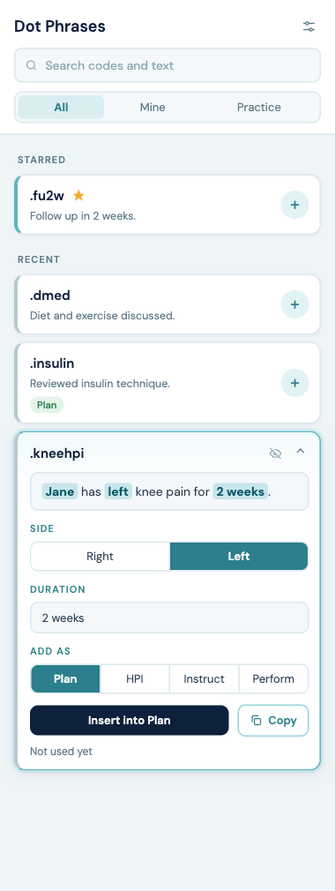
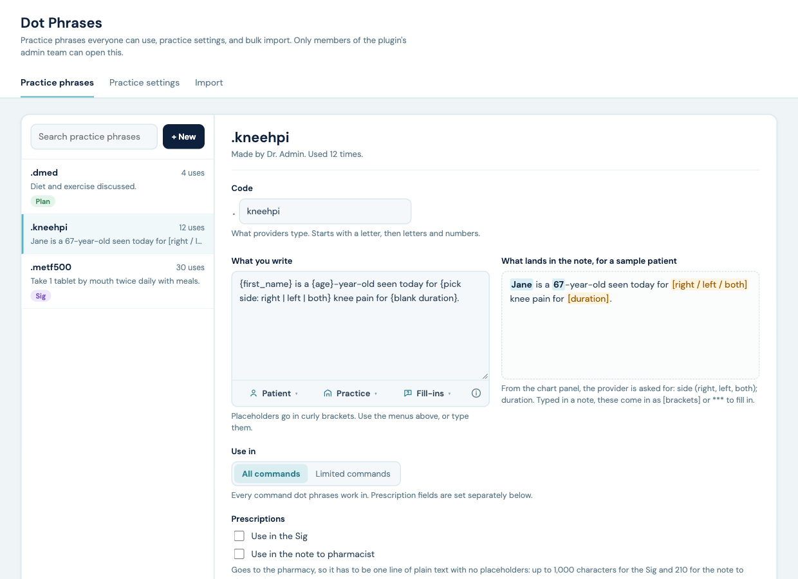

# Dot Phrases

## What it does

Providers type a short code, like `.metf500`, in a note's text box. After the command saves, the code is replaced with the saved text, filled in for the patient. A **Dot Phrases** button in the note header opens a chart panel to search phrases, insert them as a new command, copy them, and manage personal phrases. Practice admins get a **Dot Phrases** app in the app drawer for practice phrases, practice settings, and bulk import.

- **Personal and practice phrases.** Everyone can make personal phrases. Practice phrases are made by members of the Canvas team named in the plugin's `ADMIN_TEAM` setting, and everyone can use them. A personal phrase with the same code as a practice phrase is used instead of it, for that provider.
- **Placeholders.** Phrases can include patient details (`{first_name}`, `{age}`, `{subject_pronoun}`, and more), practice info set once by admins (`{after_hours_line}`), and fill-ins the provider completes: choices (`{pick side: right | left}`), blanks (`{blank duration}`), and `***`. From the chart panel the provider is asked first. Typed in a note, fill-ins come in as `[brackets]` and the command can't be recorded until each one is filled in.
- **Use in.** Personal phrases work in all commands, or in prescriptions only when a prescription box is checked. Admins can choose all commands, prescriptions only, or limit a practice phrase to specific commands, like Perform and Plan for procedure wording. A code typed somewhere it isn't set up for stays as typed, and the command explains why.
- **Prescriptions.** A phrase expands in a Sig or note to pharmacist only when it's checked for that field. Placeholders fill in first, and the filled text must still be one line of plain keyboard characters, up to 1,000 characters for the Sig and 210 for the note to pharmacist, or the code stays as typed. A code, [bracket], or `***` left in either field keeps the prescription from being reviewed or sent.
- **Starred and recently used** phrases sort to the top of the chart panel.
- **Hiding and deleting.** Anyone can hide practice phrases they don't use from their own chart panel list; typing a hidden phrase's code still works. Providers delete their own phrases, and admins delete practice phrases, after a confirm. Deleting a phrase doesn't change text already in notes.

## Problem it solves

Providers retype the same plan language, counseling notes, and Sig directions dozens of times a day. Canvas text boxes have no saved-text shortcut, and plugins can't react to keystrokes, so this plugin swaps the code after the command saves and gives providers a panel to find and insert phrases.

## Who it's for

Providers, nurses, and medical assistants who chart in Canvas notes, and the practice staff who maintain shared phrases.

## How to install

```
canvas install dot_phrases
```

Requirements:

- Canvas 1.364 or later and Canvas SDK 0.243 or later. The admin app uses per-user app drawer icons, which were added in those versions.
- The plugin creates the custom data namespace `canvas_medical__dot_phrases` on first install.

Where codes expand: Plan, History of present illness, Instruct, Perform, Assess, Diagnose, Update diagnosis, Allergy, Remove allergy, Resolve condition, Stop medication, Past medical history, Surgical history, Family history, Immunization statement, Medication statement, Goal, Update goal, Close goal, Reason for visit, Follow-up, Task, Refer, Imaging order, Vitals, and the Lab, Imaging, Referral, and Uncategorized document review commands. Prescribe, Refill, and Adjust prescription expand in the Sig and note to pharmacist.

Known limits:

- Questionnaire, ROS, Physical Exam, and Structured Assessment text answers don't save a plugin edit, so codes don't expand there. Change Medication, Clipboard, Private Note, Visual Exam Finding, and Snooze Protocol can't be edited by plugins.
- The four review commands can't block recording. A phrase set to all commands still expands there, and any [brackets] or *** left in it can be recorded unfilled, including in a message to the patient. To keep a practice phrase out of review commands, limit it to other commands.
- Recording is blocked per command. Signing the whole note with an unrecorded command is only blocked when the practice's setting for uncommitted commands is on.
- Blocking applies to recording and review in the Canvas UI. Commands committed through the SDK aren't blocked.
- Unfilled [brackets] from a phrase are remembered for up to 14 days, the longest the plugin cache keeps anything. After that, or after a cache reset, they no longer block recording, though they stay visible in the text.
- Canvas gives plugins no practice time zone, so `{today}` and `{age}` use, in order: the browser's time zone (chart panel), the time zone the command creator's browser last reported when they opened the panel (kept up to 14 days), the provider's and then the patient's saved Canvas time zone, the time zone most of the instance's calendars use, and then UTC.
- A swap uses the personal phrases of whoever created the command. In a note shared by two providers, the creator's phrases apply.
- Text copied with the Copy button is plain text, so it isn't checked against a phrase's command limits wherever it's pasted. Admins can turn copying off.

## Configuration options

| Setting | What it does |
|---|---|
| `ADMIN_TEAM` | Name of the Canvas team (Settings, Teams) whose members manage practice phrases, practice info, settings, and import, and see the admin app. Capital letters don't matter. When empty, or no team has that name, nobody can. |

In the admin app, **Practice settings** holds:

- **Allow copying phrase text**: shows the Copy button on each phrase card in the chart panel. On by default.
- **Practice info**: values like `{after_hours_line}` used as placeholders in any phrase.
- **Import**: see below.

**Import** takes one phrase per line, `code, use in, text`, or a CSV with those three columns. Use in is `All`, or commands separated by `/` (Plan, HPI, Instruct, Perform, Sig, Note to pharmacist).

Other tools can read the signed-in staff member's phrases from `GET /plugin-io/api/dot_phrases/phrases`.

## Screenshots

The chart panel, with a phrase open and its choice and blank filled in before inserting:



The admin app, editing a practice phrase with a live preview for a sample patient:



Sample data shown; no real patients.
