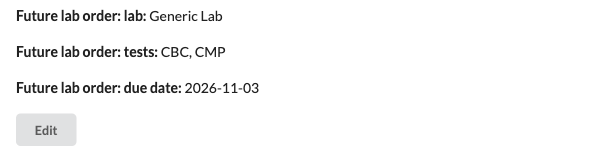

# future_lab_orders

Lets staff record a lab order that should happen later ("re-draw labs in 3
months") and reminds them with a task on the day it is due.

It is for practices that plan repeat labs ahead of time and today track them
on paper, in notes or in staff memory.

## How it works

1. **Profile fields.** Three fields appear in the patient profile
   (demographics):
   - *Future lab order: lab* - a dropdown of the instance's active lab
     partners (free text if there are none)
   - *Future lab order: tests* - free text, for example "CBC, CMP"
   - *Future lab order: due date*

   Canvas saves these as patient metadata. The plugin adds no tables.

   
2. **Daily task.** Every day at 12:00 UTC, a scheduled job looks for future lab
   orders whose due date is today or earlier. For each one it creates an open
   task, due today, titled `Future lab order due: <lab> - <tests>` and labeled
   `future lab order`. It records which due date it made the task for, so each
   due date makes one task. Changing the due date makes a new task when the new
   date arrives.

## What it does not do

It never places or sends the lab order. Sending a lab order needs a provider
signature. Whoever gets the task orders the lab in a note and signs it.

## Limits

- One pending future lab order per patient (one set of fields).
- Tests are free text and are not checked against the lab's test catalog.
- Due dates are compared in UTC.
- Inactive patients are skipped.
- At most 500 tasks per run. Anything left over is picked up the next day.

## Access

The plugin has no API endpoints or screens of its own. Anyone who can edit a
patient's profile can set the three fields. It reads lab partners, patient
metadata and teams, and writes tasks plus one patient metadata key
(`future_lab_order_task_created_for`). It logs patient ids, counts and the configured team name only.

## Configuration

| Variable | Required | Meaning |
| --- | --- | --- |
| `FUTURE_LAB_TASK_TEAM` | No | Name of the team the tasks are assigned to. If it is blank or no team has that name, tasks are created unassigned and a warning is logged. |

## Install

```bash
canvas install future_lab_orders --host <instance> --variable FUTURE_LAB_TASK_TEAM="Lab Team"
```

The plugin uses no custom data namespace, so it can be disabled or uninstalled
like any other plugin.
