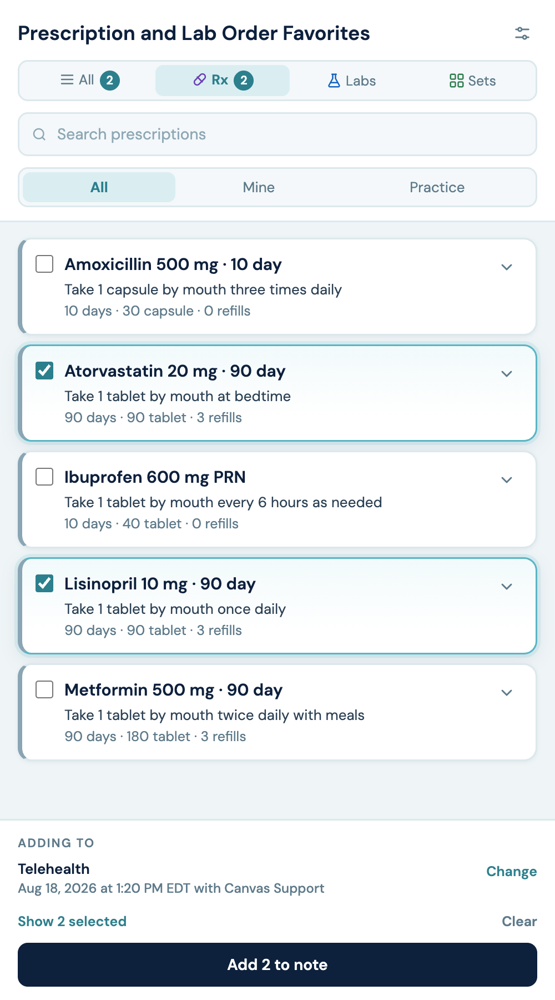
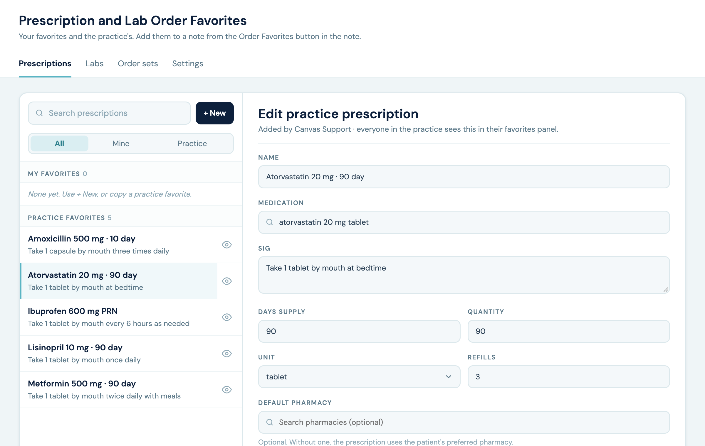

# Order Favorites

Saved prescriptions, lab orders, and order sets that staff add to a note in one action.

## What it does

- **Order Favorites button.** Every open visit or chart review note has an Order Favorites button in its header. It opens a panel on the right with All, Rx, Labs, and Sets tabs. Staff pick favorites and order sets, see what they picked in the footer, and add them all at once. Orders go into the note whose button was clicked; **Change** in the footer picks another open visit or chart review note of the same patient instead, and an open icon jumps to that note in the chart. Orders are staged for review and signing.
- **Order sets.** An order set is several prescription and lab favorites that are added together, such as a diabetes visit. Sets point to the favorites rather than copying them, so editing a favorite changes it in every set; a deleted favorite drops out. A practice set can only include practice favorites. If a favorite is picked both on its own and in a set, it is added once.
- **Practice and personal favorites.** Practice favorites are shared with everyone. Anyone can save personal favorites from the panel, copy a practice favorite to make their own version, or hide practice favorites they don't use.
- **Order Favorites in the app drawer.** Everyone gets an Order Favorites icon in the app drawer with a **My favorites** tab, to create, edit, copy, and hide favorites without opening a note. Favorites admins also get tabs to manage practice favorites, choose which order types the practice uses, manage the admin list, and import practice favorites from CSV.

Replaces the `prescription-favorites` and `lab_order_favorites` plugins.

## Problem it solves

Staff re-enter the same prescriptions and lab orders visit after visit: the same medication, sig, quantity, and refills, or the same lab partner, tests, and diagnoses. Each one is a separate command filled in by hand. Order Favorites saves them once and adds any number of them, or a whole order set, to the note in one click, staged so the prescriber still reviews and signs.

## Who it's for

- Providers and clinical staff who place the same orders often.
- Care managers and medical assistants who prepare orders in a provider's note for the provider to sign.
- Practice leads who keep a shared set of standard orders for everyone.

## Screenshots




## How to install

1. Install the plugin.
2. Set the `FIRST_ADMIN` variable to the login email of the person who will manage practice favorites, on Settings → Plugins or with `canvas config set`. That person can then add more admins in the admin app's Settings tab.

While `FIRST_ADMIN` is empty or doesn't match exactly one active staff member, the practice has no admins, and only Canvas support can manage practice favorites. The first time the named person opens Order Favorites from the app drawer, they are added to the admin list; after that `FIRST_ADMIN` is not read again.

Canvas's support login (the "Canvas Support" staff record, which has the same staff key on every instance) is always a favorites admin, so Canvas support can add admins for a practice that has none. It isn't shown in the admin list and doesn't count toward the "at least one admin" rule.

Needs a Canvas release with per-user app drawer icons (1.364 or later).

## Configuration options

- **`FIRST_ADMIN` variable:** login email of the first favorites admin (see How to install).
- **Order types** (admin app → Settings): prescriptions, labs, and order sets can each be turned off. At least one of prescriptions or labs stays on.
- **Admins** (admin app → Settings): add or remove favorites admins. There is always at least one.
- **Import** (admin app → Settings): load practice favorites from a CSV file (see Import format).

## Who is named on the order

- **Prescriptions:** the note's provider, when they are active and have an NPI. Otherwise the person adding the order. A care manager adding to a provider's note does not become the prescriber.
- **Lab orders:** the favorite's ordering provider if one is saved and still active with an NPI, then the note's provider, then the person adding.

Both can be changed in the command before it is signed.

## Lab favorites that go out of date

Each time a lab favorite is added, its lab partner and every test code are checked against the instance's live lab catalog. If the partner is inactive or any test is no longer offered, the whole favorite is skipped with a message and nothing partial is added. Admins see "Needs fixing" next to those favorites in the admin app.

## Import format

One row per favorite. Prescriptions and labs can be in the same file. Import is at the bottom of the admin app's Settings tab, where you can also download the template.

```
type,name,details
rx,Atorvastatin 20 mg · 90 day,atorvastatin 20 mg tablet|Take 1 tablet by mouth at bedtime|90|90|tablet|3
lab,Vitamin D check,Generic Lab|Vitamin D 25-OH|E55.9|no|
```

- **rx details:** medication | sig | days supply | quantity | unit | refills | pharmacy NCPDP id (optional)
- **lab details:** lab partner | tests | diagnoses (optional) | fasting yes/no (optional) | comment (optional)

Separate several tests or diagnoses with `;`. A medication must match its exact name in the medication search, or its FDB code. A test matches its order code or exact name. Rows with an unknown or ambiguous value are listed with the reason and not imported.

## Patient access

The panel opens only from a note Canvas already showed the user, and **Change** lists only that patient's notes. Plugins can't read Canvas's patient-group access rules, so the plugin's API doesn't check them itself; it relies on Canvas's chart screens for those limits.

## Data

Favorites, hidden favorites, the admin list, and settings are stored in the plugin's custom data namespace `canvas_medical__order_favorites`. The plugin starts with no favorites.
