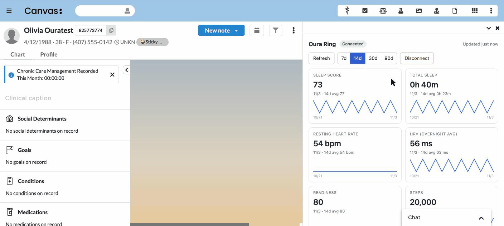
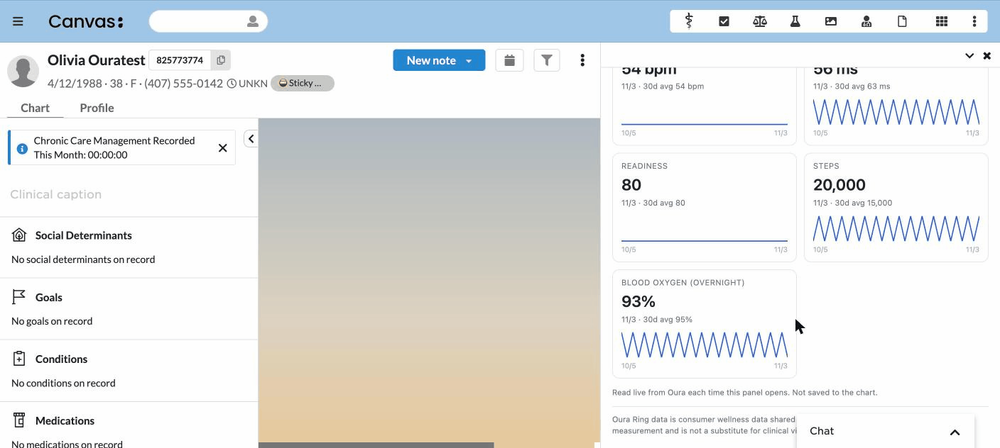
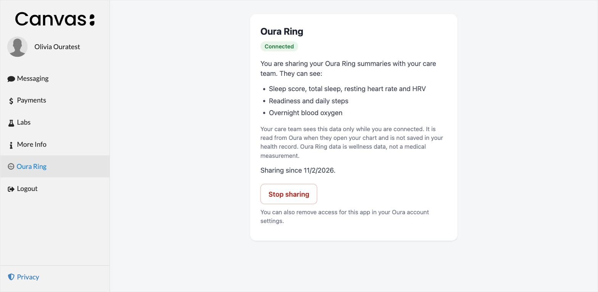

# Oura Ring Viewer

## What it does

Oura Ring Viewer brings a patient's Oura Ring data into the Canvas chart. The
patient connects their ring with one tap from the patient portal, or from a
link their care team sends, and approves sharing in Oura. The chart then shows
last night's sleep score, total sleep, resting heart rate and HRV, plus
readiness, steps and overnight blood oxygen, with trends over the last 7, 14,
30 or 90 days. Data is read live from Oura each time the chart opens and is
never stored. Patients can stop sharing from the portal at any time.

## Problem it solves

Patients who wear an Oura Ring often want their clinician to see how they are
sleeping and recovering, but today that means showing screenshots from the Oura
app during a visit, or typing numbers into a message. The care team only sees a
single moment, has no trend, and cannot check before the visit. This plugin
replaces that with a live, read-only view in the chart, under the patient's
control, without copying any wearable data into the health record.

## Who it's for

- **Primary care, concierge and direct primary care practices** following
  sleep, recovery and activity between visits.
- **Behavioral health and sleep medicine clinicians** who want objective sleep
  trends alongside what the patient reports.
- **Health coaches, care managers and longevity or performance clinics** who
  track readiness and activity over weeks.
- **Patients** who already wear an Oura Ring and want their care team to see it.

## How to install

1. Create an application in the [Oura developer portal](https://developer.ouraring.com)
   with the `daily` and `spo2` scopes, and register this redirect URI exactly:
   `https://<your-instance>/plugin-io/api/oura_ring_viewer/callback`
2. Install the plugin:

   ```bash
   canvas install oura_ring_viewer --host <your-instance>
   ```

3. In the instance's plugin settings, fill in the variables listed under
   [Configuration options](#configuration-options). The plugin reports any
   missing or unusable setting to staff by name.
4. The patient portal menu now shows **Oura Ring**, and staff see an
   **Oura Ring** app in the patient chart.

Oura's sandbox serves test data without a ring. Leave `OURA_ENVIRONMENT` unset
to try the plugin end to end before going live. Using real patient data needs
Oura's approval of your application beyond its 10-user development limit.

## Screenshots

The care team view in the patient chart (Oura sandbox data):





The patient's view in the portal, showing what is shared and the Stop sharing button:



## Scope and clinical framing

Oura data is **consumer wellness data**, so this plugin presents it as
patient-generated health data and never as clinical vitals. The chart carries a
"not a medical device" disclaimer.

**v1 does not write Observations into the chart.** Charting wearable data is a
clinical-workflow decision that belongs to the practice, not to the plugin
author, so it is deliberately left out of the first release and can be offered
later as an opt-in command.

## How a patient connects

**From the patient portal (one tap).** The plugin adds **Oura Ring** to the
portal menu. The patient taps **Connect Oura Ring**, Oura opens in a new tab,
they sign in and approve, and the portal page updates on its own. A chart
staff already have open on that patient picks it up within 30 seconds.
It works the other way too: when a patient stops sharing, an open chart
clears their data within a minute. That check reads only the connection
status, never Oura. The same
page shows that they are sharing and has a **Stop sharing** button. There is
no link to copy: the patient is identified by their own portal session.

**From the care team (one click).** Staff open the Oura Ring tile in the chart
and choose **Send to patient**. The patient gets a portal message with a secure
link, taps it on their phone, and approves in Oura. The chart panel checks back
every 10 seconds and fills in on its own when they do. **Copy link instead**
covers patients who do not use the portal.

Why staff send a link instead of pressing a connect button themselves: an
Oura sign-in connects whoever is signed in on that browser, which in the chart
would be the clinician, not the patient.

Link details:

- A link lasts 3 days, since portal messages are often read later, and works
  once. A link that runs out unused shows as **Link expired** in the chart.
- While a link is out, **Resend to patient** and **Copy link** reuse that same
  link, so nothing the patient already has stops working. Only **Send a new
  link** replaces it, and asks first.
- A patient who starts from the portal while a staff link is out uses the same
  pending connection, so either path completes it.

## Testing and verification

The plugin has 317 tests at 100% line coverage, strict mypy is clean, and
`canvas validate` loads every handler in the Canvas sandbox.

Verified against Oura itself:

- Every URL, scope, endpoint path, query parameter and response field the
  plugin uses, checked against Oura's published OpenAPI specification (1.43).
- The real client and normalizer, run against Oura's live sandbox. Oura's
  `end_date` is exclusive; the client already requests one day past the window.
- A full connection on a Canvas test instance: staff link, Oura consent,
  callback, and every card populated from Oura's sandbox data.

Reviewed with the Canvas Plugin Assistant's security and database-performance
checklists: both pass. Reports are in `reviews/`.

## Permissions requested

Only `daily` and `spo2`. Those cover the sleep, readiness and activity
summaries, the sleep periods, and overnight SpO2, which is everything v1 reads.

The plugin deliberately does **not** request `personal` (age, weight, sex,
email), intraday `heartrate`, or `workout`. Not holding data is a stronger
position than holding it and ignoring it, and it means no Oura user identifier
is stored either.

## Partial access

Oura's consent screen lets a patient untick individual scopes. If an endpoint
returns 403, the fetch skips that metric family, keeps the rest, and tells
staff which data the patient is not sharing. A 401 is different: it means the
access token expired, so the fetch refreshes once and retries.

If every endpoint returns 403, nothing was fetched and the plugin records an
`all_forbidden` error. Oura's API documentation confirms the usual cause: a 403
"usually means the user's subscription to Oura has expired and their data is
not available", so the chart tells staff the patient's membership may have
lapsed.

## Data model

**No Oura data is stored.** The Oura API Agreement says an aggregator "shall
not store or cache any User Data or Oura Data", and a plugin that brings Oura
data into many practices' health records is one. So each chart load fetches
the selected window from Oura (one call per endpoint, five in all), shapes it
in memory, and returns it. Nothing from Oura's responses is written anywhere.

The plugin keeps two small tables, both per patient:

- `OuraOAuthToken`: the connection itself (access and refresh tokens, expiry,
  granted scopes).
- `OuraSyncState`: connection status only. When data was last read, the last
  error code, and the pending link's nonce. No health values.

Disconnect deletes both rows. Because there is no stored data, there is no
retention job and nothing to purge.

## Configuration options

Six plugin variables, two of them sensitive:

| Variable | Sensitive | Notes |
|---|---|---|
| `OURA_CLIENT_ID` | no | From the Oura API application |
| `OURA_CLIENT_SECRET` | yes | From the Oura API application |
| `OURA_REDIRECT_URI` | no | `https://<your-instance>/plugin-io/api/oura_ring_viewer/callback`, registered with Oura exactly |
| `OURA_ENVIRONMENT` | no | `production`, or anything else for sandbox |
| `OURA_MAGIC_LINK_SECRET` | yes | Random string of at least 32 characters, used to sign patient links |
| `OURA_ACCESS_RULE` | no | Who may see a patient's Oura data: `care_team` (default) or `practice` |

Each route checks only the settings it needs and reports anything missing or
unusable to staff by name, rather than failing when a patient taps a link.

- `OURA_ENVIRONMENT` fails safe: any value other than `production` routes to
  the sandbox, so a typo cannot reach live patient data.
- `OURA_REDIRECT_URI` must be `https`, since the connection link it derives
  carries a bearer token. Plain `http` is accepted only for `localhost`.
- `OURA_MAGIC_LINK_SECRET` shorter than 32 characters is refused.
- `OURA_ACCESS_RULE` with any value other than `care_team` or `practice` is
  refused and reported, never treated as permission to widen access.

## Who can see a patient's data

A Canvas staff session only proves the caller is staff; per the Canvas
SimpleAPI docs it "makes no assertions about the particular staff member". So
every staff route checks the caller against the practice's `OURA_ACCESS_RULE`
before it reads or changes anything for that patient:

- **`care_team`** (default): only staff who are active members of the patient's
  care team. Least privilege, so it is what a practice gets unless it chooses
  otherwise.
- **`practice`**: any active staff member, for practices that do not maintain
  care teams or that rely on covering clinicians.

Inactive staff never qualify under either rule. The caller is identified from
the session headers Canvas sets itself and strips from client requests. A
refused request changes nothing: no link is issued and nothing is deleted.

## Security notes

- **Staff routes** require a Canvas staff session and then pass the
  per-patient access rule above. **Portal routes** (`/portal/...`) require a
  signed-in patient and act only on the patient named by the Canvas session,
  never on an id in the URL. A login acting for someone else, such as a parent,
  is refused: connecting a wearable is the patient's own decision. **Link
  routes** (`/connect`, `/callback`) are public by necessity and are protected
  instead by signed, expiring tokens bound to a single-use nonce.
- Link and OAuth state tokens carry a type claim, so neither can be replayed as
  the other. The signing algorithm is pinned, so an unsigned `alg: none` token
  is rejected.
- `patient_id` is accepted only as letters, digits and hyphens, on every route,
  before it reaches the database or a template.
- No route returns token material. Tokens are stored without encryption at
  rest because the Canvas sandbox blocks `cryptography`, the same documented
  constraint as `dexcom-cgm-viewer`; `services/crypto.py` is the seam for real
  encryption when the platform allows it.
- The chart page loads no external scripts and writes every value with
  `textContent`, never `innerHTML`.
- **Disconnect** (staff) and **Stop sharing** (patient) delete both rows this
  plugin holds for the patient, but do not yet revoke the grant at Oura.
  Patients can revoke it in their Oura account, as the portal page says.

## Known limitations

- **Production use needs Oura's approval.** Oura limits a new API application
  to 10 users and, under its API Agreement, approves each practice as an end
  customer before real patient data is used.
- **Disconnect does not yet revoke the grant at Oura.** Patients can revoke it
  in their Oura account, as the portal page tells them.

## Development

Requires Python 3.12 or newer and [uv](https://docs.astral.sh/uv/).

```bash
uv sync
uv run pytest -q --cov=oura_ring_viewer
uv run mypy oura_ring_viewer tests
canvas validate oura_ring_viewer
```

`canvas validate` loads every handler in the real Canvas sandbox, which
enforces import and builtin restrictions that ordinary tests do not, so run it
after any change to imports.

The Canvas SDK's pytest plugin creates the plugin's tables in a SQLite test
database using the same DDL generation as a production install, so storage,
fetch and handler tests run against the real schema. One test checks directly
that a fetch writes no Oura values to the database. Handler tests render the
real templates through the SDK's own template engine. The Oura client is mocked
at the HTTP layer; nothing in the test suite touches the network.

## License

MIT. See `LICENSE`.
