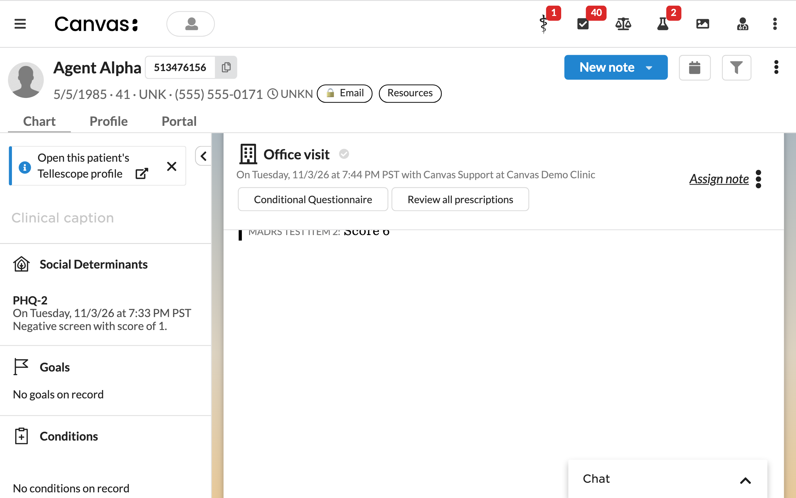
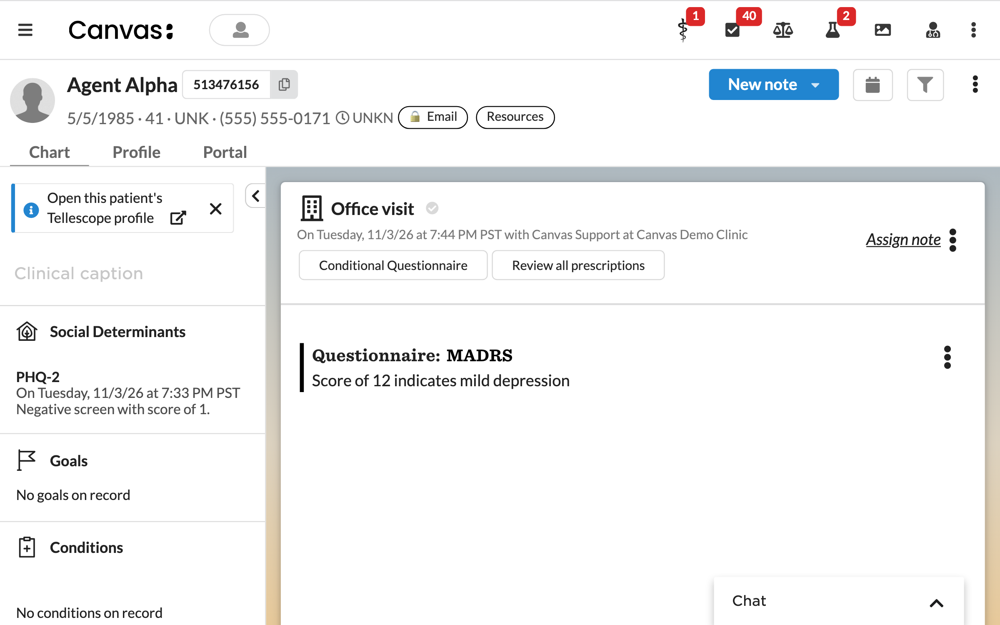
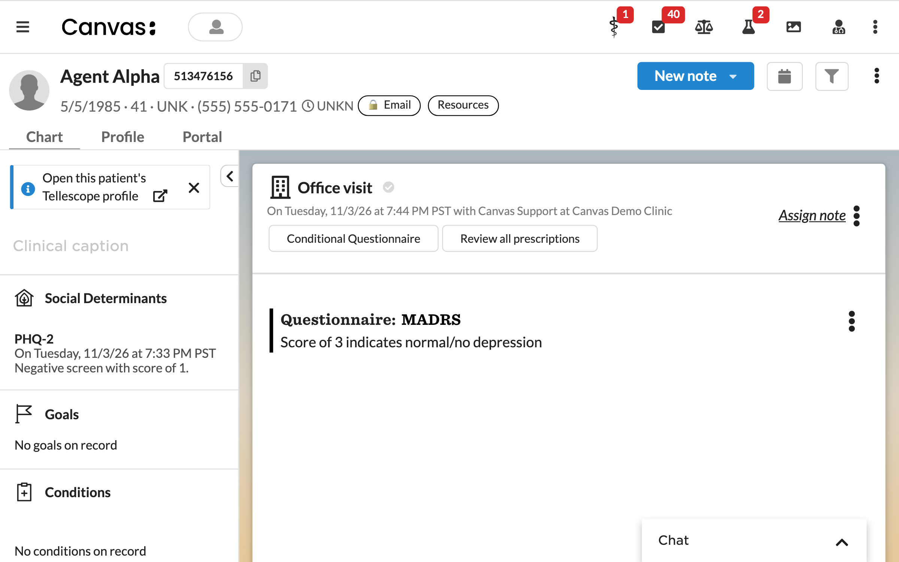

# PHQ-9 to MADRS Workflow Automation

## What it does

Automates the depression screening workflow by:

1. Automatically originating a MADRS (Montgomery-Åsberg Depression Rating Scale) questionnaire when a PHQ-9 is committed with a score of 20 or below
2. Adding a standardized score interpretation to the Social Determinants section when a MADRS questionnaire is committed

## Problem it solves

Clinical staff conducting depression screening often need to follow a PHQ-9 with a MADRS assessment when the patient's score falls in a range that warrants further evaluation. Doing this by hand means remembering to add the MADRS questionnaire, calculating the score, and writing the interpretation consistently every time. This plugin removes the manual steps and standardizes the documentation.

## Who it's for

Clinical staff who document patient encounters and perform depression assessments — providers, clinicians, care coordinators, and behavioral health specialists.

## How it works

### PHQ-9 trigger

When a clinician commits a PHQ-9 questionnaire with a score of 20 or below, the plugin automatically adds a MADRS questionnaire to the same note.

### MADRS interpretation

When the MADRS questionnaire is committed, the plugin calculates the total score and writes the interpretation to the Social Determinants section using standard MADRS ranges:

| Score | Interpretation |
|-------|----------------|
| 0-6   | Normal/No depression |
| 7-19  | Mild depression |
| 20-34 | Moderate depression |
| 35-60 | Severe depression |

Results are marked abnormal when the score is 7 or higher.

The result is coded `INTERNAL` / `MADRS`. Canvas requires a code on every questionnaire result because it also creates an Observation, and the code is what tells one result's observations from another's.

## Prerequisites

- A PHQ-9 questionnaire must be configured in your Canvas instance
- A MADRS questionnaire must be installed in your Canvas instance. The plugin locates it by internal code first, then falls back to a name search containing "MADRS"

## How to install

```bash
canvas install phq9-madrs-workflow
```

## Configuration options

This plugin has no configurable secrets or settings.

## Screenshots

Committing a MADRS scored 12 shows the "mild depression" interpretation in the note; a score of 3 shows "normal/no depression". Test patient, test questionnaire.






## Running tests

```bash
uv run pytest tests/
```

## Events and effects

- **Event**: `QUESTIONNAIRE_COMMAND__POST_COMMIT`
- **Effects**: `ORIGINATE_QUESTIONNAIRE_COMMAND`, `CREATE_QUESTIONNAIRE_RESULT`
