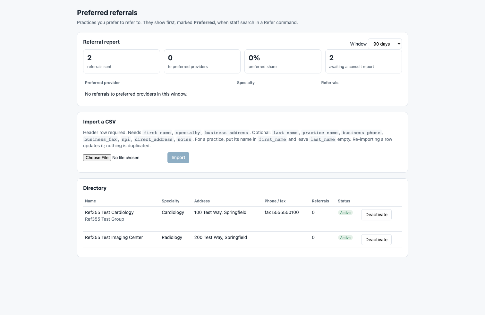

# Preferred Referrals

A practice-curated list of preferred referral providers on top of the native **Refer** command.

- **Preferred first in Refer.** When staff type in a Refer command's *Refer to* field, matching preferred providers are listed first, marked **Preferred**. The shared Canvas directory's results follow underneath. The plugin matches on name, practice name or specialty.
- **CSV import.** Admins upload a CSV from the *Preferred referrals* app in the provider menu. Re-importing a row updates it instead of making a duplicate.
- **Deactivate / reactivate.** A retired provider leaves the search. Past referrals to it are unchanged.
- **Referral report.** For the last 30, 90 or 365 days, the report shows:
  - committed referrals sent, and how many went to preferred providers
  - the preferred share
  - how many still have no consult report back
  - a per-provider count



## Who it is for

Practices that send most referrals to a known set of specialists and want those
listed first in Refer, with a count of how often staff actually pick them.

## Install

From the `extensions/preferred-referrals` folder:

```
canvas install preferred_referrals --host <your-instance>
```

Then set `ADMIN_STAFF_IDS` (below). Until it is set, nobody can change the directory.

## What access it grants

- **Any signed-in staff member** can open the app and read the directory and the
  referral report. The report shows counts and provider names only, never patients.
- **Staff in `ADMIN_STAFF_IDS`** can import, deactivate and reactivate providers.
  Deactivate and reactivate only touch providers this instance created
  (`is_customer_managed`), never the shared directory's rows.
- The Refer search handler reads preferred providers only. It writes nothing.
- Routes use Canvas staff-session auth. There are no public routes and no
  outside calls. Logs carry row counts only.

## How it works

Preferred providers are native `ServiceProvider` records. The plugin creates them with the ServiceProvider effect, and Canvas flags them `is_customer_managed`.

Picking one in Refer writes a normal referral to that exact record. Faxing, the referral report review, and the native **Outstanding Referrals** queue keep working with no changes. The plugin stores no data of its own.

The Refer search uses `REFER__REFER_TO__POST_SEARCH`. When nothing preferred matches, the handler returns a null payload so the directory's results are left alone.

## Configuration

| Variable | Purpose |
|---|---|
| `ADMIN_STAFF_IDS` | Comma-separated staff ids that may import, deactivate and reactivate. If empty, nobody can change the directory. Any staff member can view the directory and the report. |

## CSV format

A header row is required, and the column names are case-insensitive.

| Column | Required | Notes |
|---|---|---|
| `first_name` | yes | For a practice, put the practice name here and leave `last_name` empty |
| `specialty` | yes | Free text, for example `Cardiology`. Matched by the Refer search |
| `business_address` | yes | One line |
| `last_name` | no | |
| `practice_name` | no | |
| `business_phone`, `business_fax` | no | |
| `npi` | no | Exactly 10 digits |
| `direct_address` | no | |
| `notes` | no | |

Canvas treats `first_name` + `last_name` + `specialty` + `business_address` as one provider's identity, so changing any of these creates a new record. To retire the old one, deactivate it.

The page sends large files in batches of 200 rows.

## Not in v1

- Nearest-first sorting by patient location.
- A per-referral status pipeline beyond the native Outstanding Referrals queue.
- Automatic sending by eFax or Direct.
- Maps.
- Payer or network rules.

Every provider created through the ServiceProvider effect counts as preferred, including ones another plugin on the same instance creates.

## Development

```
uv sync
uv run pytest --cov
```
