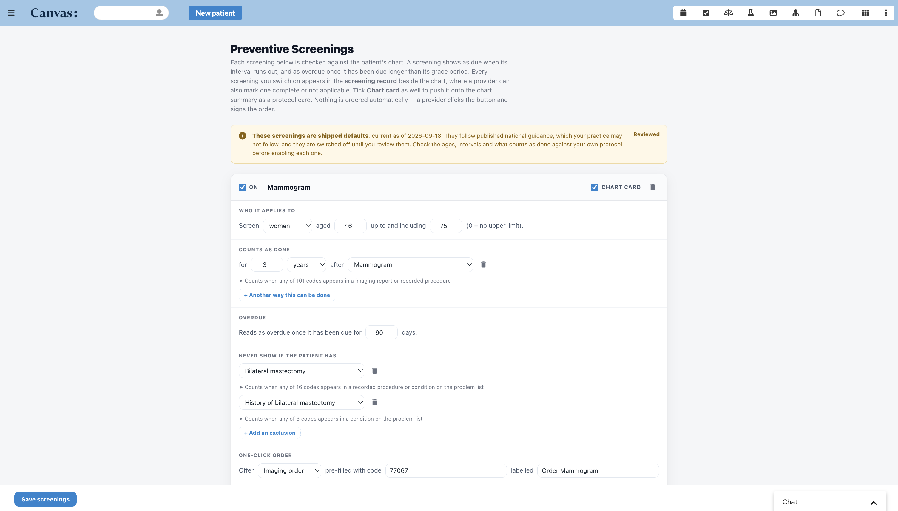
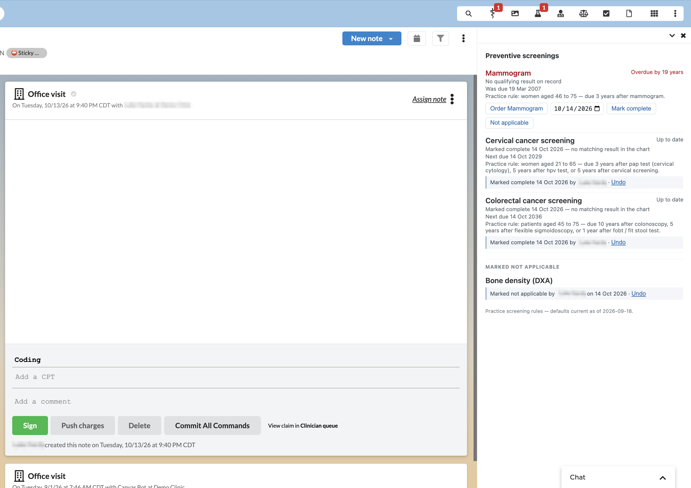
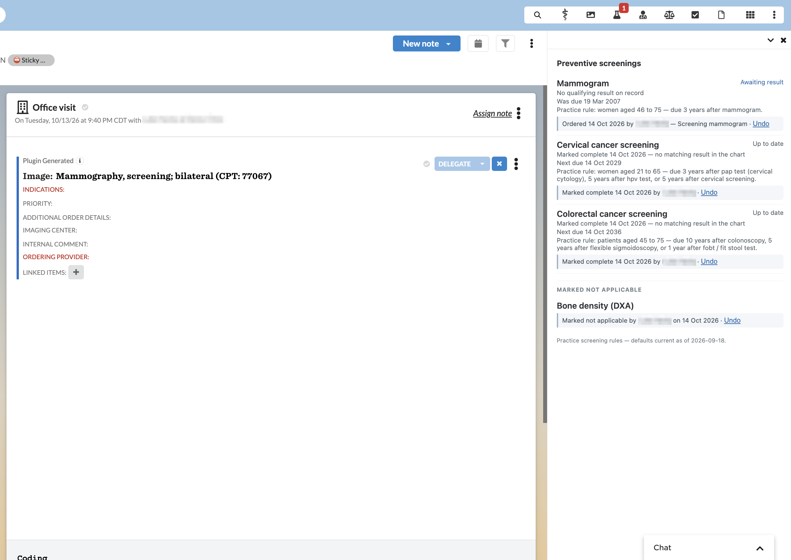
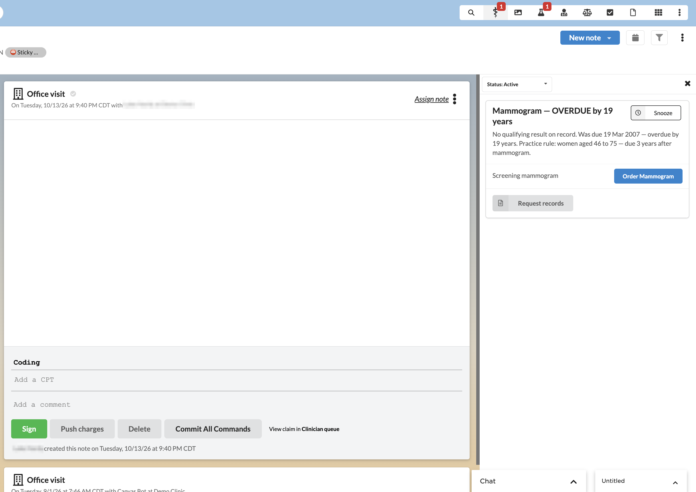

# preventive_screenings

Show which preventive screenings a patient is due or overdue for, with the date
each was last completed and a one-click order, and let the practice change the
ages, intervals and screenings themselves — without a developer.

## What it does

Every screening the practice has switched on is checked against the patient's
chart. The results appear in two places, and which ones go where is the
practice's choice:

* **The screening record**, a panel beside the chart, lists every screening the
  practice tracks — including the ones that are up to date — and is where a
  provider orders one, or marks it complete or not applicable. Always on.
* **Protocol cards** on the chart summary, for the screenings a practice wants
  at the top of the chart. **Opt-in per screening, off by default.**

A protocol card looks like this:

```
Mammogram — OVERDUE by 14 months
Last completed 12 Mar 2023. Was due 15 Mar 2025 — overdue by 14 months.
Practice rule: women aged 40 to 74 — due 2 years after mammogram.
                                                  [ Order mammogram ]
```

* **Overdue reads differently from due.** Overdue cards say so in the title,
  carry a negative `due_in` (the native protocols' own convention), and sort to
  the top of the list.
* **Nothing is ordered automatically.** The button stages the right command
  type, unsigned. The provider completes it and signs.
* **The last completed date is shown**, not just the due date.
* **A screening already ordered reads "Awaiting result"** rather than overdue,
  so it stops nagging a provider who has already acted.
* **A snoozed screening goes quiet**, and comes back on its own when the snooze
  expires.

## Problem it solves

A primary-care practice is responsible for keeping patients current on
preventive screening, and three things make that hard:

* **Nobody can answer "what is this patient overdue for?"** without digging
  through the chart. Providers make the call from memory during a visit, and
  things get missed.
* **When something is caught, ordering it is a separate hunt** through a
  different part of the UI.
* **Canvas's native protocols are fixed to published quality measures.** A
  practice that follows different intervals — a geriatrics practice setting its
  own ages for fall risk and bone density — cannot change them without a
  developer, and cannot add a screening that is not a quality measure at all.

This plugin answers all three on the chart the provider is already looking at,
and puts the rules in a form an administrator edits themselves. Each rule is
restated in plain English as it is built, so a non-developer can check that it
says what they meant.

## Who it's for

* **Primary care and family medicine**, as the core case: panel-wide preventive
  screening with the practice's own intervals.
* **Geriatrics**, which routinely diverges from national defaults on fall risk,
  bone density and when to stop screening.
* **Any practice tracking something that is not a quality measure** — there is
  no national value set for screening DXA, for instance, so bone density ships
  configured with explicit CPT codes as a worked example of doing it yourself.
* **Administrators** who own what the practice is measured against, and who get
  an editor rather than a support ticket.

Clinical staff only. Nothing in this plugin is patient-facing.

## Screenshots

**The editor.** Every screening is built from form controls and restated as a
sentence underneath, so an administrator can check it says what they meant.
`ON` tracks the screening; `CHART CARD` additionally puts it on the chart
summary.



**The screening record**, beside the chart. Every tracked screening that
applies to this patient — overdue, up to date, and the ones a provider has
marked — with the actions on each.



**A screening that has been ordered** reads "Awaiting result" rather than
overdue, and the order is staged in the open note, pre-filled.



**A protocol card**, for the screenings a practice opts into carding.



## How to install

```bash
canvas install ./preventive_screenings --host <instance>
canvas config set preventive_screenings ADMIN_STAFF_KEYS=<staff-key> --host <instance>
```

Nothing else needs enabling on the instance. The plugin creates its own
custom-data tables on install; verify with:

```bash
canvas namespace inspect canvas_medical__preventive_screenings --host <instance>
```

That should list `screeningconfig`, `screeningreview` and
`screeningattestation`. If saving later reports that the namespace may not be
set up, the migration did not run — reinstall.

The six default screenings ship **switched off**, so a fresh install changes
nothing on any chart until an administrator reviews and enables them.

## Configuration options

| Setting | Required | What it does |
| --- | --- | --- |
| `ADMIN_STAFF_KEYS` | **yes** | Comma-separated staff keys allowed to open and change the screening rules. **Fails closed**: with it unset nobody gets in, so set it at install. There is deliberately no bypass key. |

Everything else is configured in the editor rather than as a setting, and is
stored per practice in custom data — see below.

⚠️ The screening **record** panel is deliberately *not* gated to
`ADMIN_STAFF_KEYS`. It is a chart view every clinician looking after the
patient needs, and it shows only what the same person can already read on the
chart itself — the same bar Canvas applies to the chart. The editor is
restricted because it changes what the whole practice is measured against.

### The screening editor

The app drawer has a **Preventive Screenings** entry that opens the editor. Every
screening is built from form controls and restated underneath as a sentence, so
it can be checked against what was meant:

> Women aged 40 to 74 — due 2 years after mammogram; overdue after a further 90 days.

Per screening you set who it applies to (sex and age range), what counts as
having done it, how long that counts for, how long past due before it reads as
overdue, any condition that rules the screening out entirely, and which command
the order button should stage.

**On** means the practice tracks the screening, and it then appears in the
screening record beside every applicable patient's chart. **Chart card**, a
separate tick, also pushes it onto the chart summary as a protocol card. It is
off by default, including on the shipped defaults: a card is stored state that
has to be kept current on every chart it reaches, where the record panel is
computed on open and cannot go stale, so cards are worth asking for rather than
assuming.

Switching a card off does not switch the screening off. The card is taken back
off the charts it reached over the following cycle — nothing deletes a protocol
card, so it has to be overwritten — and the screening carries on being tracked
and shown in the record.

A screening can be satisfied several ways with different intervals. Colorectal
cancer screening ships configured as *10 years after a colonoscopy, 5 years after
a flexible sigmoidoscopy, or 1 year after a FOBT/FIT stool test*, so a patient
with a clear colonoscopy is not chased for a stool test.

#### Screenings that are not quality measures

Most screenings are built by picking a code set from the catalog. A screening the
catalog does not cover is configured by choosing **Custom codes…**, naming it,
saying which kind of record it lives in, and entering the codes. The shipped
**Bone density (DXA)** screening is configured this way as a worked example.

## Shipped defaults

Six screenings ship configured, **switched off, and without chart cards**:
mammogram, colorectal cancer, cervical cancer, falls risk, tobacco use and bone
density. They follow
published national guidance as of the date shown in the editor's banner.

They are off on purpose. A practice may follow different intervals, and an
instance may record results under codes these value sets do not carry. A
screening that looks configured and silently never fires — or fires on the wrong
patients — is worse than one that is visibly off. Review each one before
enabling it.

## How the cards are kept current

This whole section applies only to the screenings a practice has carded. A
practice that cards nothing runs none of it.

Protocol cards are **stored state**, not something drawn when a chart opens.
Canvas does not accept an `ADD_OR_UPDATE_PROTOCOL_CARD` effect from a chart-read
event, so a card stays exactly as it was last written until this plugin writes
it again. Two things do that writing:

* **`handlers/event_handlers.py`** reacts to the twenty events that can change
  an answer - imaging, lab and referral reports, interviews, conditions, patient
  updates, protocol overrides, and the Perform command being recorded, entered
  in error or deleted. A result recorded on the chart clears its card within
  seconds, and undoing it brings the card straight back.

  Procedures need that last group because **there is no `PROCEDURE_CREATED`
  event**, and `NOTE_CLOSED` does not fire when a note is signed. Without the
  Perform subscriptions a completed colonoscopy would keep shouting OVERDUE
  until the sweep next reached that patient.
* **`handlers/sweep.py`** is a `CronTask` running every minute, because
  the other half of the problem has no event at all: a patient turning 45, an
  interval running out, a due screening tipping overdue. When the cards are
  written the plugin also predicts the next date any of them could change and
  stores it, so the sweep revisits a patient on that date rather than
  re-examining the whole panel nightly. Each run is bounded, so it works the
  same on a panel of fifty or two hundred thousand.

No patient goes more than 90 days without being re-verified regardless of what
was predicted, so a wrong prediction is wrong for at most one cycle rather than
forever.

## The screening record, beside the chart

A card is only rendered while a screening needs attention. Canvas shows nothing
for a screening that is satisfied, so the last-completed date is visible exactly
while a screening is overdue and invisible the moment it is up to date - which
is usually when somebody asks "when did she last have one?".

So the chart carries a patient-scoped **Screening record** app. It opens a panel
beside the chart listing every screening the practice tracks that applies to
that patient, what state each is in, and when it was last completed - including
the ones that are fine, and stating plainly which ones are snoozed. A screening
appears here whether or not it is carded.

It is computed when you open it, so unlike the cards it can never be stale. It
renders the same data the cards do, from the same code path, so the panel and
the card sitting inches apart cannot disagree.

### Ordering from the panel

A screening that is due shows its order button here as well as on the card, so
a practice that cards nothing still gets the client's *"order it without
leaving the chart"*. One click stages the configured command, **unsigned**, in
the patient's open note; the provider completes and signs it.

It needs an open note, because that is the only place a command can go. With
none, the panel says so rather than failing quietly - this app sits beside the
chart and can be open when no note is.

### Screenings that are ordered and awaiting a result

Once ordered, a screening reads **"Awaiting result"** rather than overdue, with
the date and who ordered it. It stops nagging a provider who has already acted,
without pretending the screening is done - the panel still shows when it was
due.

This is bounded on purpose. After 90 days the order stops counting and the
screening reads as due again, so a request that fell through the cracks brings
the patient back rather than hiding them indefinitely. It is also undoable from
the same row.

⚠️ **It is recorded when the order is staged, not when it is signed**, and only
for orders placed through this panel. Nothing in the chart ties an order back
to a screening - an imaging order stores an opaque string and a referral
carries no code at all - so an order placed directly in the chart is not seen
here, and a staged order the provider then abandons leaves a screening reading
"awaiting result" until the 90 days run out or somebody undoes it.

### Marking a screening complete, or not applicable

Two things the chart cannot always say for itself:

* **Mark complete** — the screening was done, but no record this plugin can read
  says so: done elsewhere, on paper, or recorded under a code the configured
  value set does not carry. The provider gives the date it happened and, where
  a screening can be satisfied several ways, which one it was — because a
  colonoscopy covers ten years where a stool test covers one.
* **Not applicable** — this screening does not apply to this patient, for a
  reason the configured exclusions do not express.

Both are reversible from the same panel, and both show **who recorded them and
when**, beside the screening. That is the point rather than a detail: a
clinician reading "up to date" can always see whether that came from an imaging
report or from a colleague's say-so, and the card says so too.

A statement is **merged with the chart, never substituted for it**. A real
result that is more recent always wins, on both the last-completed date and on
how long the screening is covered for. Marking something complete can supply
evidence the chart lacked; it cannot overrule evidence the chart has. And it is
not "never ask again" — it buys exactly the interval the provider chose, then
the screening comes back.

**Any staff member with a Canvas session can open it.** It is a chart view
rather than an administrative one, and it shows only what the same person can
already read on the chart itself. The editor is separately restricted to
`ADMIN_STAFF_KEYS`, because that changes what the whole practice is measured
against.

> This plugin does **not** add a chart-summary section. Canvas's section
> configuration replaces the practice's section list rather than adding to it,
> so a plugin that used it would override whatever layout the practice had
> configured and collide with any other plugin doing the same. The panel above
> is one click instead of inline, and touches nothing of the practice's.

## Limits and known gaps

* **Sex-specific screenings match a recorded sex at birth of F or M only.** A
  patient whose sex is recorded as other, unknown or blank is not shown a
  sex-specific screening. Unknown is never treated as a match.
* **A screening with no completion signal is ignored**, because it could never
  read as done and would sit on the chart forever.
* **Procedures are dated by the note's date of service**, so a procedure
  imported without one is dated by that note rather than by when it happened.
* **At most 40 screenings**, each with at most 6 completion signals and 6
  exclusions, and at most 25 codes per signal. Names and other free text are
  capped at 200 characters (64 for a code): the text goes onto every card, and
  a scheduled run has a fixed size budget for the cards it returns.
* **A screening switched off, or un-carded, is not forgotten immediately.**
  Nothing deletes a protocol card, so its card has to be overwritten on every
  chart it reached; the sweep does that over the following cycle.
* **A lab order cannot be staged pre-filled.** `LabOrderCommand` requires a lab
  partner before it will accept test codes, and this plugin cannot know which
  partner a practice uses, so a lab screening's button opens the right command
  with the test left for the provider to pick. `refer` is the same by
  construction - it has no code field at all.
* **Marking a screening complete is stored by this plugin, not written into the
  chart.** It is visible in the screening record and on the card, with its
  author, but it is not a discrete chart record and does not appear in FHIR or
  anywhere else in Canvas. For a result that belongs in the chart, record it in
  the chart - this plugin reads imaging, lab and referral reports, procedures,
  interviews and conditions, and a real record always takes precedence.
* **Any staff member with a session can mark a screening complete or not
  applicable, for any patient.** The SDK exposes no role or care-team check to
  narrow that with. Nothing is destroyed or hidden by it - a more recent real
  result always wins - every statement carries its author where clinicians can
  see it, and every one is reversible.
* Eligibility is age, sex and excluding conditions. Risk-based screening (family
  history, smoking pack-years) is not expressible yet.
* **The plugin loads the eCQM value sets at startup**, which costs roughly
  16 MB of resident memory (about 52 MB for the package as a whole). That is
  paid once per plugin-runner boot, not per chart or per sweep, and it is paid
  even by a fresh install whose screenings are all disabled. Resolving the
  value sets lazily on first use would avoid it; it is a known efficiency gap
  rather than a correctness one.
