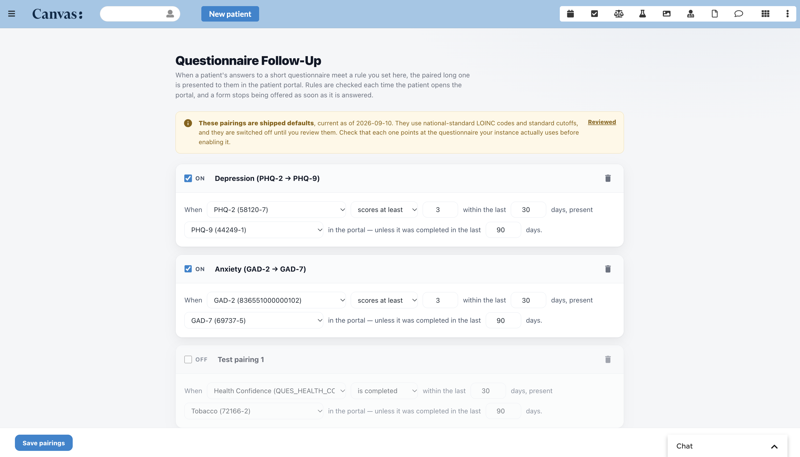
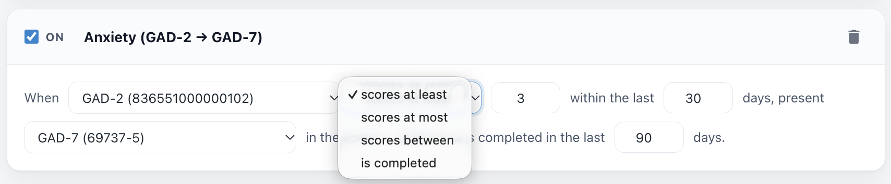
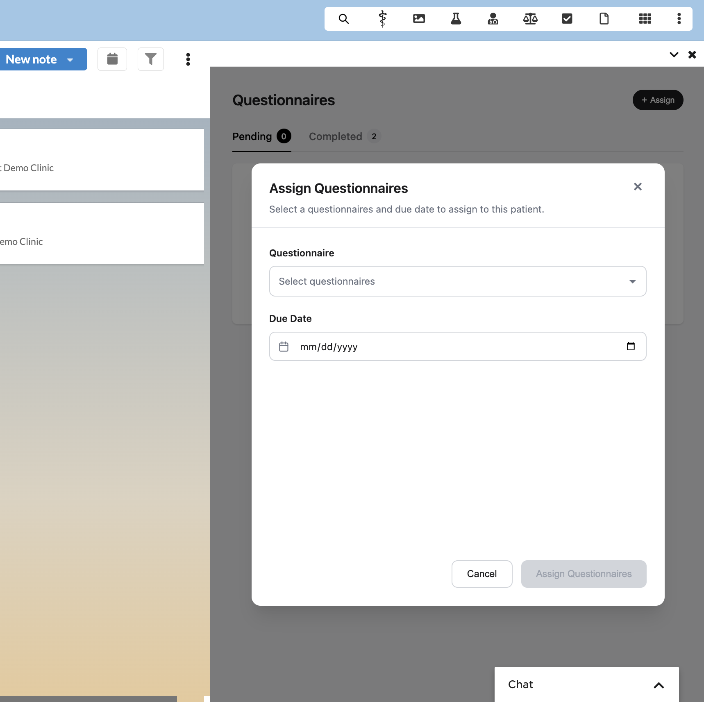
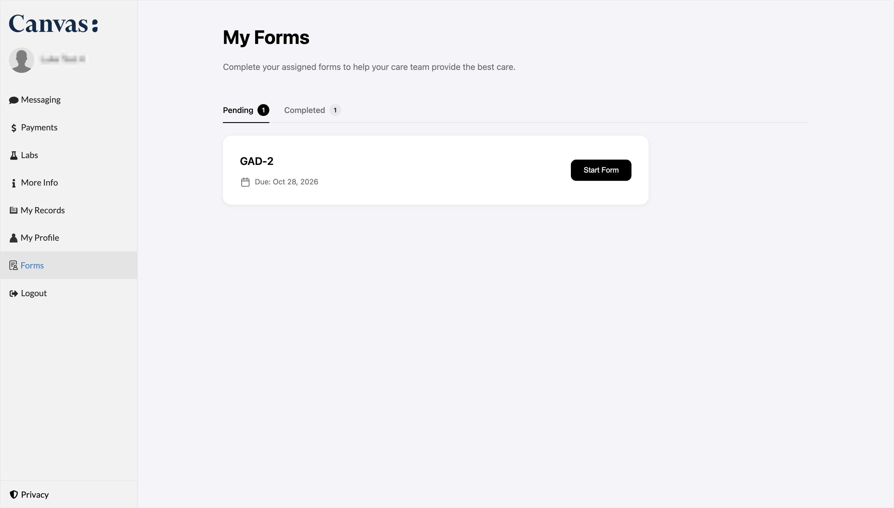
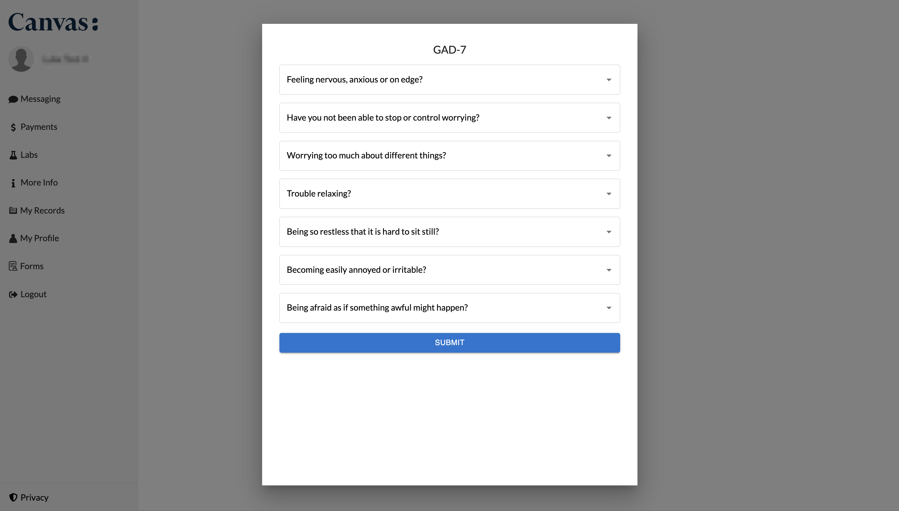

# Questionnaire Follow-Up

Automatically present the paired long-form questionnaire to a patient in the patient
portal when they screen positive on a short one — PHQ-2 → PHQ-9, GAD-2 → GAD-7, or any
pairing a practice defines, configured in the EHR rather than in code.

## What it does

A practice sets up pairings in an admin app: _when this short questionnaire scores this
way, present that long one in the portal_. From then on the plugin watches the chart.

Every time a patient opens the patient portal, the plugin re-reads their chart and asks,
for each pairing, whether they are owed the long form. If they are, it appears in the
portal for them to complete, and their answers commit into a note so the care team sees
them. If they are not — they never screened, scored below the cutoff, or already
answered — nothing appears.

Because the answer is recomputed on every portal visit rather than queued in advance:

- a form stops being offered the moment it is answered;
- patients screened before the plugin was installed are picked up with no backfill;
- changing a pairing takes effect immediately, for everyone.

It does not matter **how** the short questionnaire was answered. A nurse entering it in a
note during a visit and a patient completing it in the portal produce the same result.

## Problem it solves

When a patient screens positive on a short instrument, they are supposed to get the
longer one. In practice that depends on whoever is in the room remembering, and it does
not always happen — so positive screens go un-followed-up, and the ones that are caught
often arrive late.

The opposite failure matters too: a patient who has just completed a long questionnaire
should not be handed it again the next time they screen. Both halves are handled here —
a configurable window stops the same long form coming back too soon.

Doing this without a plugin means either a manual process that depends on memory, or a
developer writing a rule per instrument and changing code every time a cutoff moves.

## Who it's for

Any practice that screens with paired short/long instruments and wants the follow-up to
happen on its own:

- **Behavioral health**, where a patient who screens positive on the short depression
  questionnaire should get the full one before the visit ends.
- **Primary care** screening for several concerns at once, which needs the follow-ups to
  happen automatically without the same long questionnaire coming back for a patient who
  just completed it.

The pairings are configured by an administrator, not a developer. Adding an instrument,
moving a cutoff, or turning a pairing off is a change in the app, not a release.

## Screenshots

**Setting up pairings**



Each rule reads as a sentence. The shipped defaults arrive switched off, stamped with the
date their cutoffs were last reviewed, and each questionnaire picker lists what this
instance actually has.

**Four ways a score can fire a rule**



_Scores at least_ is the standard positive screen. _Scores at most_ is for instruments
where a **low** score is the concerning one. _Scores between_ pairs a severity band to its
own follow-up. _Is completed_ ignores the score entirely, which is the only way to pair an
instrument whose answers are not numeric.

**The short questionnaire reaches the patient**





_These two screens belong to a separate form-delivery plugin, not to this one_ — included
because sending the short form is the common way a pairing gets triggered. Entering it in
a note during a visit works exactly the same way. See
[Working alongside a form-delivery plugin](#working-alongside-a-form-delivery-plugin).

**The follow-up appears on its own**



The patient scored at or above the cutoff on the GAD-2, so the GAD-7 is waiting the next
time they open the portal. The questionnaire will appear on the portal home screen. Nobody asked for it; the pairing did. Their answers commit into
a note on the chart.

## How to install

```bash
canvas install questionnaire_followup
```

Then, on the Canvas instance:

1. **Set `ADMIN_STAFF_KEYS`** to a comma-separated list of the staff keys allowed to edit
   pairings. **Do this straight after installing** — it fails closed, so until it is set
   nobody can open the editor:
   ```bash
   canvas config set questionnaire_followup ADMIN_STAFF_KEYS=<staff-key>[,<staff-key>...]
   ```
2. **Confirm the patient portal is enabled** for the patients you expect to use this.
   Follow-ups reach a patient when they open the portal.
3. **Check the questionnaires you want to pair are active**, with
   `use_case_in_charting = "QUES"`, so they appear in the pickers.
4. **Open the app drawer → Questionnaire Follow-Up**, review the shipped pairings against
   your own questionnaires, and switch on the ones you want.

Follow-ups are recorded in the chart as questionnaire commands, so no further setup is
needed for the responses to reach the care team.

## Configuration options

| Variable           | Purpose                                                       | Default                                              |
| ------------------ | ------------------------------------------------------------- | ---------------------------------------------------- |
| `ADMIN_STAFF_KEYS` | Comma-separated staff keys allowed to view and edit pairings. | Empty — **fails closed**, nobody can open the editor |

Everything else is configured in the app rather than through variables. Each pairing
carries:

| Setting             | What it controls                                                    |
| ------------------- | ------------------------------------------------------------------- |
| Short questionnaire | The screen that triggers the pairing                                |
| Score rule          | `scores at least` / `at most` / `between` N and M / `is completed`  |
| Lookback            | How recent a screen has to be to count                              |
| Long questionnaire  | What gets presented in the portal                                   |
| Re-ask window       | How long to leave a patient alone after they complete the long form |

Up to **50** pairings. Every portal page load reads the whole set, so the editor stops
there and the server refuses a larger save.

### Shipped defaults

PHQ-2 → PHQ-9 and GAD-2 → GAD-7, at the standard cutoff of 3, seeded **switched off** and
stamped with the date their cutoffs were last checked. Review each against the pickers,
then enable it.

On the very first load, the plugin looks up each questionnaire the defaults name — PHQ-2,
PHQ-9, GAD-2, GAD-7 — on your instance and points the pairing at the code your instance
actually carries. Instances do not all code these the same way, and published panel codes
are not a safe assumption, so a code guessed in advance would leave a rule that looks
configured and silently never fires. Where a name is not found, or is shared by two
questionnaires with different codes, the published code is left in place and the editor
flags it.

This happens once, when there is no saved configuration yet. It never changes pairings you
have already set up.

### Who can edit

`ADMIN_STAFF_KEYS` is not editable from the page itself, so the editor can never lock out
the last administrator, and every administrator is visible in one setting the practice
controls. There is no built-in bypass account. The app-drawer icon is visible to everyone
— the SDK has no per-staff icon control — so access is enforced when the page is opened,
and refused attempts are logged.

## Working alongside a form-delivery plugin

This plugin decides **which** follow-up a patient needs. It does not send the first
questionnaire out. That can reach the patient either way:

- **Entered directly into a note** — a nurse or clinician charts the short questionnaire
  during a visit and commits it.
- **Sent to the patient portal** by a form-delivery plugin such as Canvas's
  `patient_portal_forms`, where a staff member assigns it and the patient completes it at
  home.

**Both work, and both trigger the follow-up in exactly the same way.** This plugin reads
completed questionnaires from the chart and does not care how they got there, so no
configuration changes between the two routes.

**The two plugins can run side by side.** Neither interferes with the other: a delivery
plugin assigns forms without subscribing to the portal event this one answers.

**What a patient sees if your practice runs both:** forms in two places. An assigned
questionnaire appears wherever the delivery plugin puts it, typically its own entry in the
portal menu. An automatic follow-up from this plugin appears on the portal's own pages,
including the landing page the patient reaches when they sign in. That is expected rather
than a misconfiguration, and the landing-page prompt is the more prominent of the two.
**Both sets of responses commit to the chart**, so the care team sees them either way.

**Where the follow-up lands:** in the note holding the screen that triggered it, while that
note still accepts commands — the "before the visit ends" case. If the short questionnaire
was answered through a delivery plugin that files portal responses into a note of its own,
the follow-up joins that same note, so a screen and its follow-up stay together even
though there was no visit. If that note has been locked or signed, Canvas creates a new
one.

## How it works

Canvas asks the plugin which forms a patient should see every time the portal loads a page
(`PATIENT_PORTAL__GET_FORMS`). For each enabled pairing:

1. Find the patient's most recent **committed** response to the short questionnaire, within
   that pairing's lookback window.
2. Score it by summing the recorded ordinal answers. An interview with nothing numeric in
   it is unscoreable, and unscoreable never counts as a positive screen.
3. Check the score against the pairing's score rule.
4. Check whether the patient already answered the long form — either since this screen, or
   recently enough that a new positive should not re-ask yet.
5. If they still owe it, present it, with the answers set to commit into a note.

Pairings are addressed by questionnaire **code**, not id, so loading a new version of a
questionnaire does not break a pairing and the same configuration is portable between
instances. The code does not have to be LOINC — whatever your instance uses is what gets
stored. A code this instance does not have is flagged in the editor, and the pairing does
nothing rather than guessing at a substitute.

The work is batched across pairings rather than repeated for each one: a patient with no
recent screen costs a single query, and a patient who is owed something costs a fixed
number however many pairings are configured.

## Layout

| Path                         | What it does                                                             |
| ---------------------------- | ------------------------------------------------------------------------ |
| `handlers/event_handlers.py` | The portal handler — turns owed follow-ups into forms                    |
| `services/decision.py`       | Which follow-ups a patient owes, and why not when they owe none          |
| `services/config_store.py`   | Load / save / seed the pairings                                          |
| `services/questionnaires.py` | Resolve stable codes to current questionnaires; list them for the editor |
| `services/scoring.py`        | Score screens, and match a score against a pairing's score rule          |
| `api/routes.py`              | Admin endpoints, access-gated                                            |
| `api/admin_page.py`          | The pairing editor page                                                  |
| `applications/admin_app.py`  | App-drawer entry point                                                   |
| `models/followup_config.py`  | The custom-data table                                                    |

`models/` must stay a **package**, not a single `models.py`, or the SDK never generates
the migration and the custom-data table is never created.

## Testing

From the repository root (the project environment is managed by `uv`):

```bash
uv run pytest --cov=questionnaire_followup --cov-branch
```

To exercise the portal handler without logging into the portal, put a patient id into a
copy of `fixtures/PATIENT_PORTAL__GET_FORMS.ndjson`, start a local plugin runner in one
terminal (it keeps running):

```bash
uv run canvas run-plugin questionnaire_followup
```

and send the fixture to it from another:

```bash
uv run canvas emit <your-fixture>.ndjson
```

Any `PATIENT_PORTAL__FORM_RESULT` effect printed is a form that patient would be shown. No
output means the plugin decided they are owed nothing.

The pairing editor is a page served as a string, so pytest only ever sees it as text. What
it renders is checked separately, in Node:

```bash
uv run python scripts/check_admin_page.py
```

That checks the page's script parses, that it renders balanced markup with rule and
questionnaire names escaped, and that the pairing cap holds. Run it after any change to the
editor's markup or JavaScript — nothing else covers it.

### Why didn't a patient get a follow-up?

The plugin logs only when it presents something, so a patient who is owed nothing leaves
no trace. To see the decision itself, open this as a listed admin:

```
/plugin-io/api/questionnaire_followup/admin/diagnose?patient=<patient id>
```

It reports every configured pairing and the point at which each one stopped — no screen on
file, a screen outside the lookback, a score that did not meet the rule, a questionnaire
code this instance does not have, a follow-up already answered, or the pairing simply being
switched off. It is read-only, and it runs the same decision the portal handler runs, so it
describes what actually happened rather than what should have.

## Known limits

- Scoring is a sum of ordinal answers. An instrument scored some other way (weighted items,
  "any positive answer") can be paired with the _is completed_ rule, but pairing it on a
  computed score would need a scoring mode added to the pairing.
- Pairings are short **form** → long form. A single broad intake that branches into several
  follow-ups by section would key on questions rather than questionnaires.
- Follow-ups reach the patient when they open the portal. Nothing is pushed to a patient
  who never logs in.
