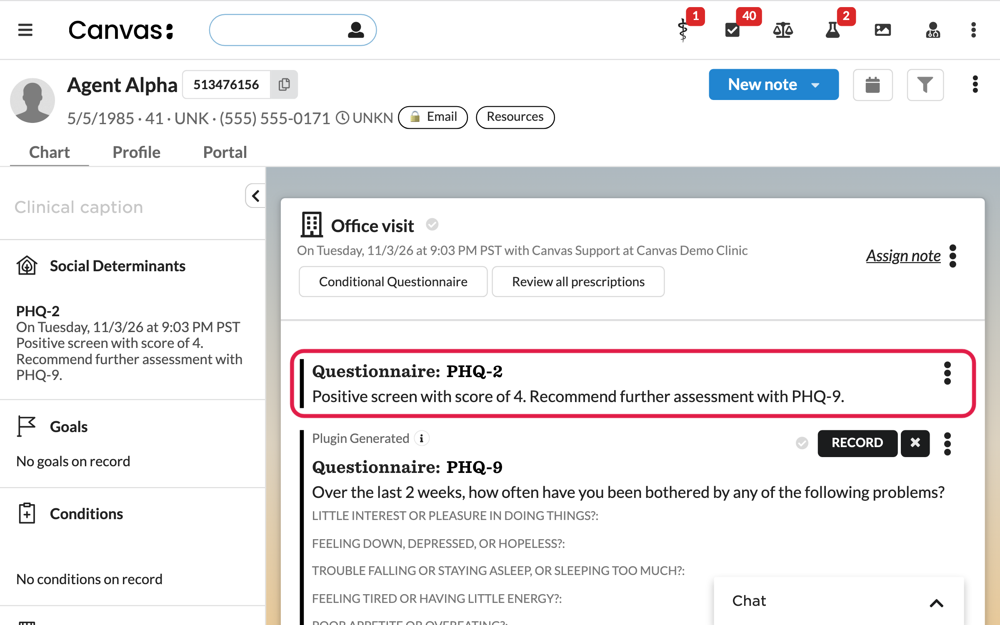
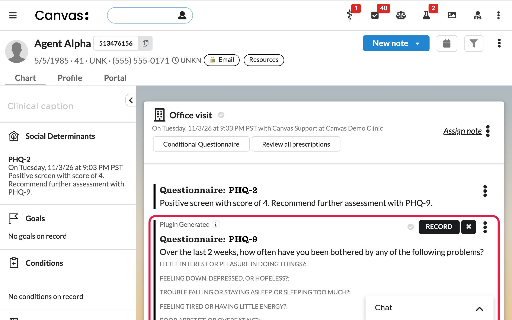
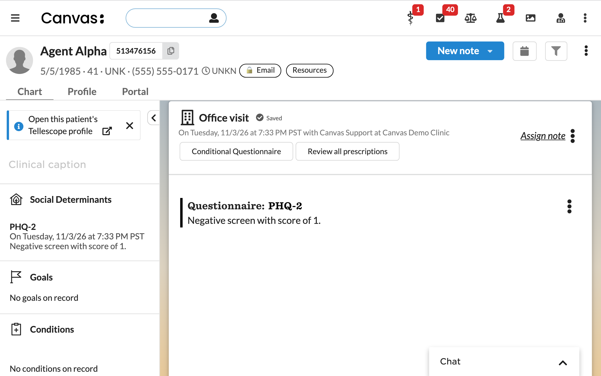
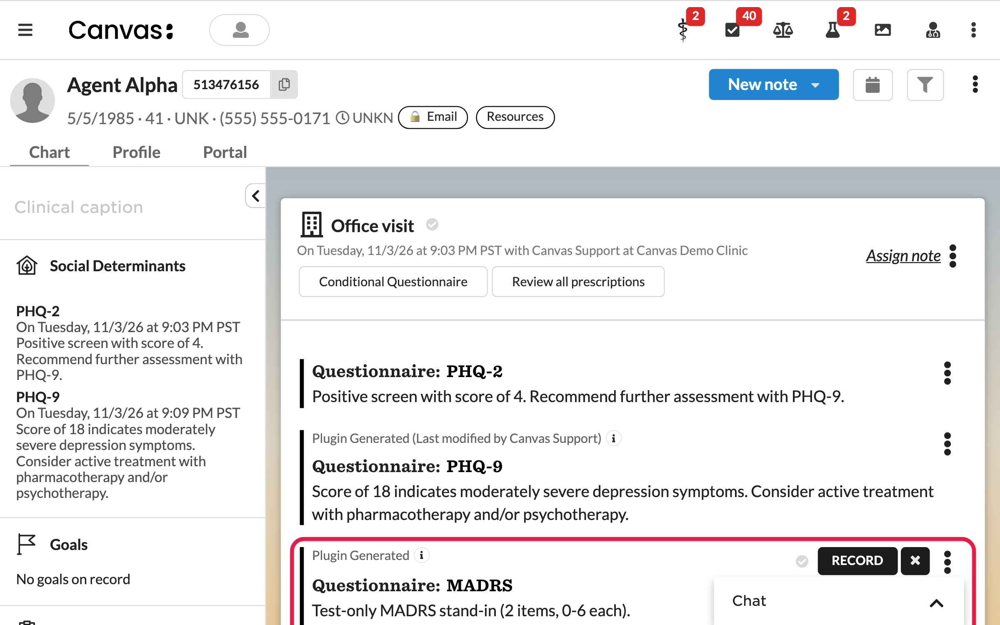
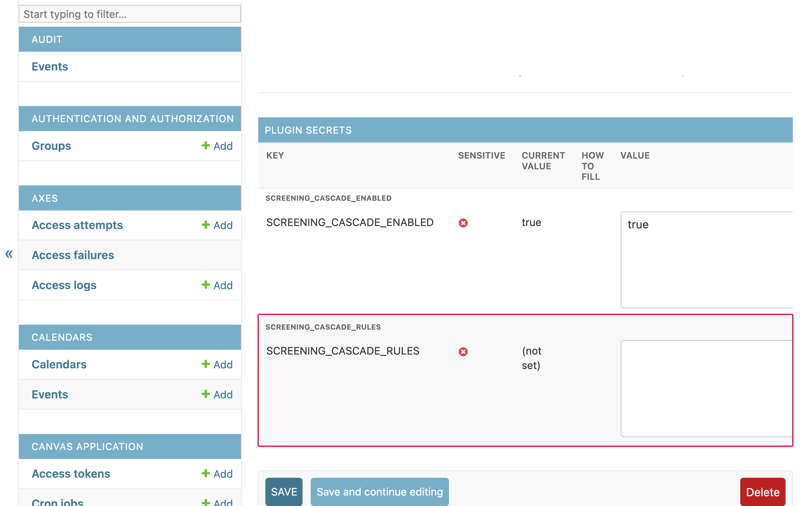

# Screening Follow-up Cascade (canvas__screening_cascade)

When a patient screens positive on a short questionnaire, add the longer one to
the same note, so the follow-up doesn't depend on someone remembering it.

Out of the box:

| Screener | Positive when | Follow-up added |
|---|---|---|
| PHQ-2 (LOINC 58120-7) | score 3 or more | PHQ-9 (LOINC 44249-1) |
| GAD-2 (SNOMED 836551000000102) | score 3 or more | GAD-7 (LOINC 69737-5) |

The codes are the ones Canvas provisions by default. Every part of a rule is
configuration: the screener, the comparison, the threshold, the follow-up, a
cooldown window, an optional clinician preference, and an optional score write-back.

## What it does on each committed questionnaire

1. Ignores it unless `SCREENING_CASCADE_ENABLED` is on, and unless a rule's
   `trigger` matches the questionnaire's code system and code.
2. Totals the answer values. If any scored question is unanswered, or a value is
   not a number, it does nothing (a partial total would understate the result).
3. If the rule has a `result` coding and Canvas does **not** already score this
   questionnaire natively, it writes the score with `CreateQuestionnaireResult`.
   The result carries a narrative ("Score: 4. Positive screen, PHQ-9 recommended.")
   and is flagged abnormal when the threshold is crossed. Canvas's built-in PHQ-2
   and GAD-2 are scored natively, so this step is for practices that built their own
   copies.
4. If the score crosses the threshold, it originates the follow-up questionnaire on
   the same note, unless the patient already has that follow-up on this note or
   from the last `cooldown_days` days (default 14). Uncommitted copies count too.

## Who it is for

Practices that screen with PHQ-2 or GAD-2 (or any coded screener) and want the
full instrument queued on the same note whenever the screen is positive.

## Install

From the `extensions/screening-cascade` folder:

```
canvas install canvas__screening_cascade --host <your-instance>
```

## What access it has

- It runs only on the `QUESTIONNAIRE_COMMAND__POST_COMMIT` event. It has no API
  routes, no UI and makes no outside calls.
- It reads the committed command, its interview and answers, questionnaire
  definitions, the note's provider id, and earlier interviews for the same patient
  (for the cooldown check).
- It writes only two things: a questionnaire command on the same note, and (when
  configured) a questionnaire result for the screener. It never edits or deletes
  existing records.
- Logs carry questionnaire codes, rule names and scores, never patient details.

## Settings

| Variable | Default | Meaning |
|---|---|---|
| `SCREENING_CASCADE_ENABLED` | `false` | `true` (or `yes`, `on`, `1`) turns the plugin on. Anything else is off. |
| `SCREENING_CASCADE_RULES` | (blank) | The rules, as a JSON list (see below). Blank means the two built-in rules above. Set, it replaces them. |

## Turning it on

The plugin is off until you set:

```
canvas config set canvas__screening_cascade SCREENING_CASCADE_ENABLED=true --host <instance>
```

With only that set, the two default rules above apply.

## Custom rules

Set `SCREENING_CASCADE_RULES` to a JSON list. It **replaces** the defaults, so include
them if you still want them. If the JSON is invalid, the plugin logs the error and
does nothing. It does not fall back to the defaults.

```json
[
  {
    "name": "PHQ-2 to PHQ-9",
    "trigger": {"code_system": "LOINC", "code": "58120-7"},
    "operator": ">=",
    "threshold": 3,
    "follow_up": {"code_system": "LOINC", "code": "44249-1"},
    "cooldown_days": 14,
    "result": {"code_system": "INTERNAL", "code": "screening_cascade_phq2"},
    "bands": [
      {"min": 0, "max": 2, "label": "Negative screen"},
      {"min": 3, "max": 6, "label": "Positive screen, PHQ-9 recommended"}
    ]
  }
]
```

| Field | Required | Meaning |
|---|---|---|
| `name` | no | Shown in logs. |
| `trigger` | yes | Code system and code of the screener. The code system match ignores case. |
| `operator`, `threshold` | with a follow-up | One of `>=`, `>`, `<=`, `<`, `==`, and a number. |
| `follow_up` | one of these three | The questionnaire to originate. It must be active and able to originate in charting. |
| `follow_up_by_staff` | | Staff id to questionnaire. Uses the note's provider. Falls back to `follow_up`. |
| `result` | | The coding for the `CreateQuestionnaireResult` Observation. Leave it out to skip the score write-back. |
| `cooldown_days` | no | Whole days, default 14. `0` still blocks a second copy on the same note. |
| `bands` | no | Score ranges (inclusive) and labels for the result narrative. A score outside every band gets no label. |

A rule with only `trigger` and `result` scores a questionnaire without cascading
(AUDIT-C, for example).

## Example: PHQ-9 to MADRS

Some practices add a clinician-rated MADRS whenever a PHQ-9 is committed with a
total of 20 or less (above 20 they act on the PHQ-9 directly). Add this rule to the
list. Use the code your MADRS questionnaire carries in Canvas: `79788-9` (LOINC) is
common; practices that built their own often use `INTERNAL` / `MADRS`.

```json
{
  "name": "PHQ-9 to MADRS",
  "trigger": {"code_system": "LOINC", "code": "44249-1"},
  "operator": "<=",
  "threshold": 20,
  "follow_up": {"code_system": "LOINC", "code": "79788-9"},
  "cooldown_days": 14
}
```

The threshold and direction are the practice's clinical call; `>=` with `10`
("moderate or worse") is the other common choice.

## Clinician preference

`follow_up_by_staff` picks a different follow-up for some clinicians. For example,
MADRS by default but HAM-D for the clinicians who prefer it:

```json
{
  "name": "PHQ-9 to MADRS, or HAM-D by clinician preference",
  "trigger": {"code_system": "LOINC", "code": "44249-1"},
  "operator": "<=",
  "threshold": 20,
  "follow_up": {"code_system": "LOINC", "code": "79788-9"},
  "follow_up_by_staff": {
    "<staff id>": {"code_system": "INTERNAL", "code": "HAMD"}
  }
}
```

- The choice follows the **note's provider**, not whoever commits the PHQ-9.
- A provider not listed gets `follow_up`. Leave `follow_up` out to add nothing for
  them.
- An admin keeps the list in this setting, keyed by staff id (the id in the staff
  profile URL), with no new data model. Clinicians can't change it themselves.
- Staff ids are matched with or without dashes.

## Limits

- Scores are a plain sum of answer values. Instruments with reverse-scored items or
  subscales need their own scoring. If a PHQ-9 copy gives its last question (how
  difficult the problems made things) a numeric value, that value counts toward
  the total; check your copy before setting a PHQ-9 threshold.
- It does not create tasks. Task routing for high-risk scores is a separate plugin.
- The follow-up is originated empty. Answers are not carried over from the screener.

## Screenshots







## Development

```
uv run --frozen pytest
```

## Credits

The PHQ-9 to MADRS example and the
clinician-preference option follow earlier single-purpose workflows (a PHQ-2 to PHQ-9
follow-up and a PHQ-9 to MADRS workflow). MIT licensed.
