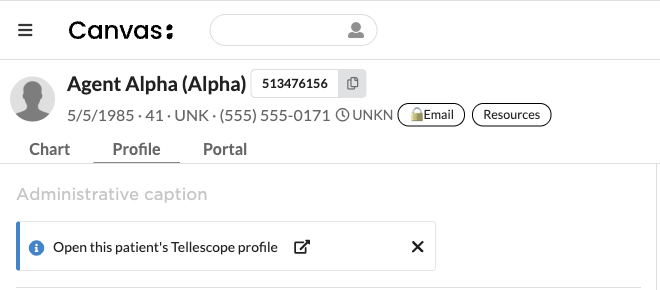

# Tellescope Banner

Shows a banner on the patient chart (and the patient profile) that links to the
patient's profile in [Tellescope](https://tellescope.com), plus a
"Tellescope Profile" chart app that opens that profile in the right chart pane.
It replaces the old "Tellescope banner" protocol that was loaded by hand for
practices with a Tellescope integration.



Who it is for: practices that run patient engagement in Tellescope and want staff
one click away from the patient's Tellescope record.

## What access it grants

- Anyone who can open the chart sees the banner and its link. The link only opens
  Tellescope; the user still needs their own Tellescope login.
- The plugin reads patient external identifiers in one configured system. It writes
  only the banner (add or remove). No API routes.
- The banner never calls out. The chart app calls the Tellescope API only when
  `TELLESCOPE_API_KEY` is set, only when a user opens the app, only over https,
  and only to look up the one open patient's linked enduser. The key is sent in
  the `Authorization` header and is never logged or shown.
- Logs name the setting that is missing or invalid, or carry ids, status codes
  and exception class names. Never a patient value, response body or key.

## How it works

The plugin builds the link from a URL template you set in the plugin settings.
The template can use two placeholders:

| Placeholder | Filled with |
|---|---|
| `{patient_id}` | The Canvas patient id (patient key). |
| `{external_id}` | The value of the patient's external identifier whose system equals `TELLESCOPE_IDENTIFIER_SYSTEM`. |

The patient value is URL-encoded before it goes into the link, so a value with
`/`, `?`, `&` or spaces can't change the link's path or query.

The banner is added or refreshed when:

- a patient is created or updated (`PATIENT_CREATED`, `PATIENT_UPDATED`)
- a patient external identifier is created, updated or deleted
  (`PATIENT_EXTERNAL_IDENTIFIER_*`)

### Fails closed

The plugin shows no banner, and removes one it showed before, when:

- `TELLESCOPE_PROFILE_URL_TEMPLATE` is not set
- the template is not an `https://` URL, has no placeholder, uses a placeholder
  other than the two above, or has stray `{` / `}`
- the template uses `{external_id}` and `TELLESCOPE_IDENTIFIER_SYSTEM` is not
  set, or the patient has no non-blank identifier in that system

### Chart app: Tellescope Profile

A patient chart app (icon in the chart's app list) opens the patient's
Tellescope profile in the large right chart pane.

- With `TELLESCOPE_API_KEY` set, it asks the Tellescope API for the enduser
  linked to this Canvas patient: `source` "Canvas" with `externalId` equal to
  the patient key, or a `references` entry of type "Canvas" with that id. It
  then opens `https://business.tellescope.com/endusers/<enduser id>`. This needs
  no external identifier in Canvas.
- Without an API key, it opens the same link as the banner (the template).
- If neither gives a link, or the lookup fails, the pane shows a short message
  instead: not set up, not an https API URL, key not accepted (401/403),
  Tellescope error (other 4xx/5xx or a non-JSON reply), Tellescope unreachable,
  or no linked profile. Opening the app again retries.

### Existing patients

The plugin does not loop over every patient on install. An existing patient
gets the banner the next time their record or external identifiers change.

## Configuration

| Variable | Required | Example |
|---|---|---|
| `TELLESCOPE_PROFILE_URL_TEMPLATE` | For the banner | `https://business.tellescope.com/endusers/{external_id}` |
| `TELLESCOPE_IDENTIFIER_SYSTEM` | Only with `{external_id}` | The `system` your Tellescope sync writes on the patient's external identifier |
| `TELLESCOPE_API_KEY` (sensitive) | No; turns on the API lookup in the chart app | A Tellescope API key with read access to endusers |
| `TELLESCOPE_API_URL` | No | Defaults to `https://api.tellescope.com/v1`; must be `https://` |

Use the profile URL format your Tellescope workspace uses; the examples above
are placeholders.

## Install

```bash
canvas install tellescope_banner --host <instance> \
  --variable TELLESCOPE_PROFILE_URL_TEMPLATE='https://business.tellescope.com/endusers/{external_id}' \
  --variable TELLESCOPE_IDENTIFIER_SYSTEM='<identifier system>'
```

Set `TELLESCOPE_API_KEY` afterwards in the plugin's settings in Canvas admin
(it is a sensitive value, so keep it out of shell history).

Run it from the `extensions/tellescope_banner` folder.

## Tests

```bash
uv run --frozen pytest
```
